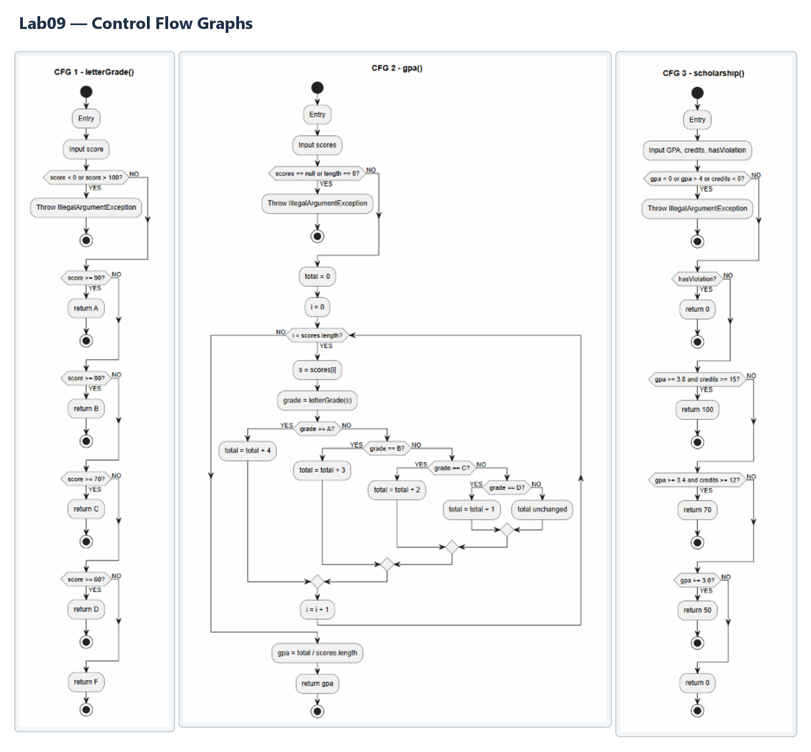

# Лаборатори №9 — Код хамралт: JaCoCo-гоор тестээ хөтлөх

- **Оюутан:** О. Доржсамбуу
- **Оюутны код:** B232270071
- **Хичээл:** F.CSA313 — Программ хангамжийн чанарын баталгаа ба тест
- **Орчин:** Windows 11, PowerShell

## Орчны хувилбар

Төсөл Java 17 source compatibility-тэй. Локал орчинд OpenJDK 25.0.2, Maven 3.9.16, JUnit Jupiter 5.10.2, JaCoCo 0.8.14 ашигласан. JaCoCo 0.8.14 нь Java 25-ыг албан ёсоор дэмждэг ([JaCoCo өөрчлөлтийн түүх](https://www.jacoco.org/jacoco/trunk/doc/changes.html)).

`java -version`:

```text
openjdk version "25.0.2" 2026-01-20 LTS
OpenJDK Runtime Environment Temurin-25.0.2+10 (build 25.0.2+10-LTS)
OpenJDK 64-Bit Server VM Temurin-25.0.2+10 (build 25.0.2+10-LTS, mixed mode, sharing)
```

`mvn -version`:

```text
Apache Maven 3.9.16 (2bdd9fddda4b155ebf8000e807eb73fd829a51d5)
Maven home: C:\Program Files\Apache\Maven\apache-maven-3.9.16
Java version: 25.0.2, vendor: Eclipse Adoptium, runtime: C:\Users\User\AppData\Local\Programs\Eclipse Adoptium\jdk-25.0.2.10-hotspot
Default locale: en_US, platform encoding: UTF-8
OS name: "windows 11", version: "10.0", arch: "amd64", family: "windows"
```

## Төслийн бүтэц

```text
fresh-start/
├── pom.xml
├── cfg.png                              # гурван CFG-г нэгтгэсэн зураг
├── cfg1_letterGrade().png               # letterGrade() CFG
├── cfg2_gpa().png                       # gpa() CFG
├── cfg3_scholarship().png                # scholarship() CFG
├── src/main/java/mn/edu/must/sqat/
│   └── ScholarshipCalculator.java
├── src/test/java/mn/edu/must/sqat/
│   └── ScholarshipCalculatorTest.java   # A–D үеийн тестүүд
└── results/
    ├── mvn-verify-A.txt
    ├── jacoco-A.csv
    ├── mvn-verify-B.txt
    ├── jacoco-B.csv
    ├── mvn-test-D-fail.txt
    ├── mvn-verify-final.txt
    └── jacoco-final.csv
```

`target/` нь `.gitignore`-т орсон тул репод орохгүй.

## Хэсэг A — Happy path ба эхний хэмжилт

Эхний таван хэвийн урсгалын тест бүгд амжилттай (`results/mvn-verify-A.txt`). JaCoCo-ийн эхний хэмжилт (`results/jacoco-A.csv`):

| Хэмжүүр | Хамрагдсан | Хамрагдаагүй | Нийт | Хамралт |
|---|---:|---:|---:|---:|
| Line | 15 | 10 | 25 | **60.0%** |
| Branch | 20 | 21 | 41 | **48.8%** |

Шар ромбууд нь нөхцөлийн зөвхөн нэг үр дүнгээр явсан хэсгүүд байв. Үүнд `letterGrade()`-ийн бүх үнэлгээний зам, `gpa()`-ийн null/хоосон массив ба switch-ийн C/D/F/default тохиолдлууд, `scholarship()`-ийн зөрчил болон босго нөхцөлүүд орно. Улаан мөрүүдэд хүчингүй оноо, GPA, кредитийн exception зам болон тестэд хүрээгүй буцаалтын мөрүүд байлаа.

## Хэсэг B — CFG ба 100% хамралт

CFG-г `letterGrade()`, `gpa()`, `scholarship()` гэсэн гурван хэсэг болгон шинэчилсэн.



Тус тусын зураг: [letterGrade()](<cfg1_letterGrade().png>) · [gpa()](<cfg2_gpa().png>) · [scholarship()](<cfg3_scholarship().png>).

Тэтгэлгийн CFG-ийн салааг дараах бодит тестийн методууд хамарна:

| Нөхцөл/ирмэг | YES салааны тест | NO салааны тест |
|---|---|---|
| `gpa < 0 || gpa > 4 || credits < 0` | `invalidGpaBelowZero`, `invalidGpaAboveFour`, `invalidCreditsBelowZero` | `scholarshipHundred` |
| `hasViolation` | `scholarshipViolation` | `scholarshipHundred` |
| `gpa >= 3.8` | `scholarshipHundred` | `scholarshipSeventy` |
| `credits >= 15` | `scholarshipHundred` | `scholarshipHundredCreditConditionFalse` |
| `gpa >= 3.4` | `scholarshipSeventy` | `scholarshipFifty` |
| `credits >= 12` | `scholarshipSeventy` | `scholarshipSeventyCreditConditionFalse` |
| `gpa >= 3.0` | `scholarshipFifty` | `scholarshipZeroBelowThreshold` |

Бүрэн branch/line хамралтад нийт **23 тест** шаардсан: A үеийн 5 тест дээр B үеийн 18 тест нэмсэн (`results/mvn-verify-B.txt`). B үеийн тестүүд `letterGrade()`-ийн F/C/D ба хүчингүй оноо, `gpa()`-ийн null/хоосон массив ба switch-ийн бүх үр дүн, `scholarship()`-ийн гурван тусдаа `assertThrows`, зөрчил болон босго/кредитийн салбаруудыг шалгана.

`results/jacoco-B.csv`:

| Хэмжүүр | Хамрагдсан | Хамрагдаагүй | Хамралт |
|---|---:|---:|---:|
| Line | 25 | 0 | **100%** |
| Branch | 41 | 0 | **100%** |

## Хэсэг C — Давталтын заагийн тестүүд

`gpa()`-ийн давталтын 0 / 1 / 2+ заагийг шалгасан:

| Тохиолдол | Тестийн метод | Шалгалт |
|---|---|---|
| 0 оролт, хоосон массив | `gpaEmptyArray`, `zeroIterationIsRejected` | `assertThrows(IllegalArgumentException.class, ...)` |
| 0 оролт, null | `gpaNullArray` | `assertThrows(IllegalArgumentException.class, ...)` |
| 1 дүн | `oneIterationGpa` | `gpa([95]) == 4.0` |
| 2+ дүн | `multipleIterationGpa` | `gpa([95, 85, 75, 65]) == 2.5` |

Эдгээр нэмэлт тест хамралтын хувийг өсгөөгүй: Branch аль хэдийн 41/41, Line 25/25 байсан. Гэхдээ JaCoCo давталтын бие дор хаяж нэг удаа ажилласныг л харуулна; 0/1/олон элементийн үр дүн зөв эсэхийг эдгээр заагийн тестүүд шалгана.

## Хэсэг D — Хамралт 100%, гэхдээ алдаа амьд

`letterGrade()`-д 7 заагийн утгын тест нэмсэн: `60`, `59.99`, `69.99`, `0`, `100`, `89.99`, `90`. Нийт 33 тест ажилласан.

`results/mvn-test-D-fail.txt`-д дараах тест унасан:

```text
ScholarshipCalculatorTest.gradeBoundary60IsD
expected: <D> but was: <F>
```

**Шалтгаан ба засвар:** Спецификацид 60–69.99 оноо D байх ёстой. Код дахь `score > 60` нөхцөл яг 60 дээр F буцааж байсан тул `score >= 60` болгож зассан. Засвар тусдаа `5d2f3fa` commit-оор хадгалагдсан (`Fix letterGrade threshold: 60 is D per specification`).

Засварын дараах `results/mvn-verify-final.txt`-д **33 тест бүгд амжилттай** (`BUILD SUCCESS`). `results/jacoco-final.csv`-ийн эцсийн хэмжилт:

| Хэмжүүр | Хамрагдсан | Хамрагдаагүй | Хамралт |
|---|---:|---:|---:|
| Line | 25 | 0 | **100%** |
| Branch | 41 | 0 | **100%** |

## Гол дүгнэлт

Branch хамралт 100% болсон ч `letterGrade(60)`-ийн алдаа үлдсэн. Учир нь `score > 60` ба `score >= 60` нь 60-аас бусад утгууд дээр ижил үнэн/худал салааг үүсгэж чадна. `letterGrade(65)` үнэн салаа, `letterGrade(50)` худал салааг хамруулсан тул JaCoCo хоёр салааг хоёуланг нь ногоон гэж тоолсон. Ялгаа зөвхөн зааг болох 60 дээр гарсан бөгөөд `gradeBoundary60IsD` тест алдааг илрүүлсэн. Иймээс хамралт нь тест хүрсэн мөр, салааг хэмждэг боловч гарсан үр дүн зөв эсэхийг баталдаггүй; спецификацид суурилсан заагийн тестээр нөхөх шаардлагатай.

## Коммитын дараалал

| Үе | Commit | Өөрчлөлт |
|---|---|---|
| A | `cd99bab` | Happy path тест, эхний тайлан |
| B | `0b49f78` | Бүх салаа ба мөрийн хамралт |
| C | `4c1cc79` | Давталтын заагийн тестүүд |
| D — уналт | `555d8fb` | 60 онооны алдааг илрүүлэх тест ба гаралт |
| D — засвар | `5d2f3fa` | `60`-ын харьцуулалтыг зассан |

## AI ашиглалтын тэмдэглэл

AI туслахыг тест, CFG зураглал, тайлангийн эхийг бэлтгэж сайжруулахад ашигласан. Тестүүд болон JaCoCo тайланг Maven-аар бодитоор ажиллуулж шалгасан.
